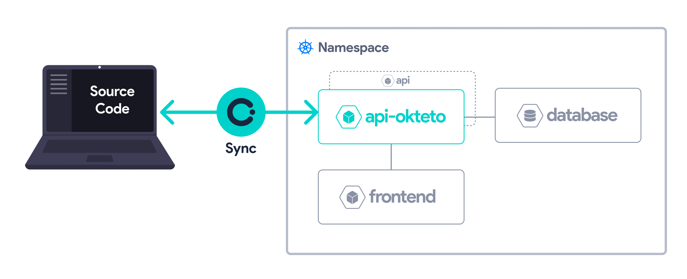

# Okteto: Application Environments on Your Kubernetes

## Overview

Okteto brings application environments and coding agents together on your Kubernetes infrastructure. You define your environment once, in a versioned Okteto manifest that reuses your existing Helm charts, Docker Compose files or Kubernetes manifests. Developers, CI pipelines, pull request previews and AI coding agents then reuse that same definition to build, deploy and test their changes.

Your code meets Kubernetes earlier in the cycle. Every change is validated against running services, not just reviewed as a code diff.

This repository contains the `okteto` CLI. Developers, CI pipelines and agents use it to work with Okteto environments.

## Develop with `okteto up`

`okteto up` is the development workflow of the Okteto CLI. It replaces a Kubernetes deployment with a development container that includes your development tools (for example maven and jdk, or npm, python, the go compiler, debuggers, etc). The development container can use any [container image](https://okteto.com/docs/development/images/), and it inherits the secrets, configmaps, volumes and every other configuration value of the original deployment.

You keep writing code in your local IDE. As soon as you save a file, the change is synchronized to the development container and your application updates instantly, taking advantage of any hot-reload mechanism you already have. No container images need to be built and no Kubernetes manifests need to be applied to see your changes.

## Why Okteto

- **One environment definition for every workflow**: developers, CI, previews and agents reuse the same versioned definition, with the configuration and access each workflow needs. This means less configuration drift and no separate stacks to maintain.
- **Validate code in Kubernetes**: changes are tested with the same deployment configuration and real service dependencies they will run with, including cloud resources managed by your deploy and destroy scripts.
- **Fast development loop**: `okteto up` syncs your code to a development container in the cluster, so you skip the _docker build/redeploy_ cycle and use the resources of the cluster instead of your laptop.
- **Agents separated from the application**: agents running in your cluster, in a hosted runtime or locally (such as Claude Code or Cursor on a laptop) call Okteto to build, deploy and test remotely. They don't need to host the application stack.
- **Live previews for every change**: developers, QA and product managers can open the running application and validate it hands-on, without setting it up locally.
- **On your infrastructure**: Okteto runs on your own Kubernetes clusters, including air-gapped installations, with centrally managed access to clusters, registries and cloud credentials.

## Okteto Open Source CLI

The Okteto Open Source CLI requires access to a Kubernetes cluster. It lets you develop your applications with `okteto up` directly in your own cluster. If you want to share application environments across your team, CI and agents, take a look at the [Okteto Platform](https://okteto.com), which is [free for small teams](https://www.okteto.com/free-tier/).

The Okteto Open Source CLI supports the following commands:

- `okteto context`
- `okteto up`
- `okteto down`

> [!NOTE]
> ⚠️ Notice: The open-source version of Okteto only supports the [dev section](https://www.okteto.com/docs/reference/okteto-manifest/#dev) of the Okteto manifest. For additional features and full functionality, consider exploring the [Okteto Platform](https://www.okteto.com/get-demo/).

## Okteto Platform

The Okteto Platform requires the installation of the [Okteto Helm Chart](https://www.okteto.com/docs/get-started/install/) in your Kubernetes cluster. In this mode, all the Okteto CLI commands are available (`build`, `deploy`, `test`, `up`, `down`, `destroy`, etc). The Okteto Platform adds:

- Application environments built from one versioned definition, including the cloud dependencies your application needs
- Remote builds, deployments and tests (`okteto test`), so developers, CI and agents don't need to run the application stack themselves
- Preview environments for every pull request, with HTTPS endpoints anyone on the team can open
- Application environments for coding agents, wherever they run, to build, deploy and test their changes before review
- Divert, which deploys only the services that change against a shared base environment
- Centrally managed access with your identity provider, scoped tokens, registry access and cloud credentials
- Environment lifecycle management at scale: automatic sleep and wake, garbage collection, quotas and resource management

And much more! Please take a look at the [Okteto Platform docs](https://www.okteto.com/docs) to learn more.

> [!TIP]
> The Okteto Platform is free for small teams. The [Okteto free tier](https://www.okteto.com/free-tier/) includes up to 5 users and 500 environments per month on your own Kubernetes cluster, with a one-year license and no credit card required.

## Features Comparison

| Feature                            | Okteto Open Source CLI | Okteto Platform           |
| ---------------------------------- | ---------------------- | ------------------------- |
| **Development with `okteto up`**   | Available              | Available                 |
| **Remote build, deploy and test**  | Not Available          | Available                 |
| **Preview Environments**           | Not Available          | Available                 |
| **Environments for Coding Agents** | Not Available          | Available                 |
| **Divert**                         | Not Available          | Available                 |
| **Centrally Managed Access**       | Not Available          | Available                 |
| **Environment Lifecycle at Scale** | Not Available          | Available                 |
| **Support**                        | Community Support      | Premium Support available |

## Useful links

- [Install the Okteto CLI](https://www.okteto.com/docs/get-started/install-okteto-cli/)
- [Quickstart](https://www.okteto.com/docs/get-started/quickstart/)
- [Okteto tutorials](https://www.okteto.com/tutorials/)
- [CLI reference](https://okteto.com/docs/reference/okteto-cli)
- [Okteto manifest reference](https://okteto.com/docs/reference/okteto-manifest/)
- [Okteto docs](https://www.okteto.com/docs/)

## Releases

Okteto is monthly released into three channels: stable, beta, and dev. When Okteto is installed, the stable channel is used by default. If you need to access features that are not yet available, you can install the Okteto CLI from the beta or dev channels. More information can be found in the [release documentation](docs/RELEASE.md).

## Support and Community

Got questions? Have feedback? Join the conversation in our [Community Forum](https://community.okteto.com/).

Follow [@OktetoHQ](https://twitter.com/oktetohq) on Twitter for important announcements.

## ✨ Contributions

We ❤️ contributions, big or small. [See our guide](contributing.md) on how to get started.

You can also join us in the [#okteto](https://kubernetes.slack.com/messages/CM1QMQGS0/) Slack channel and chat with us! If you don't already have a Kubernetes Slack account, [sign up here](https://slack.k8s.io/).

### Thanks to all our contributors!

<!--  https://contrib.rocks -->
